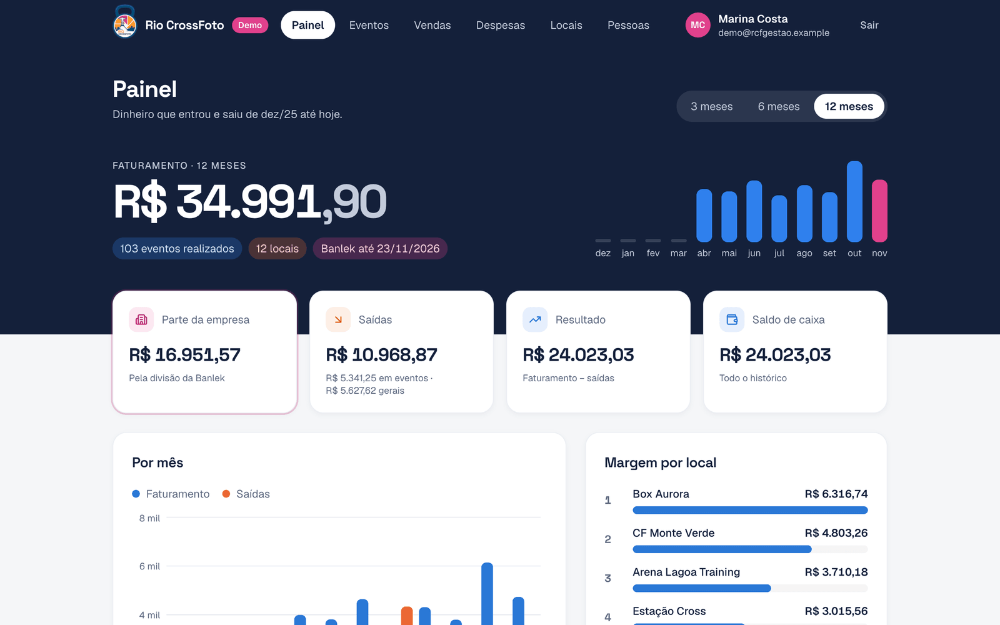
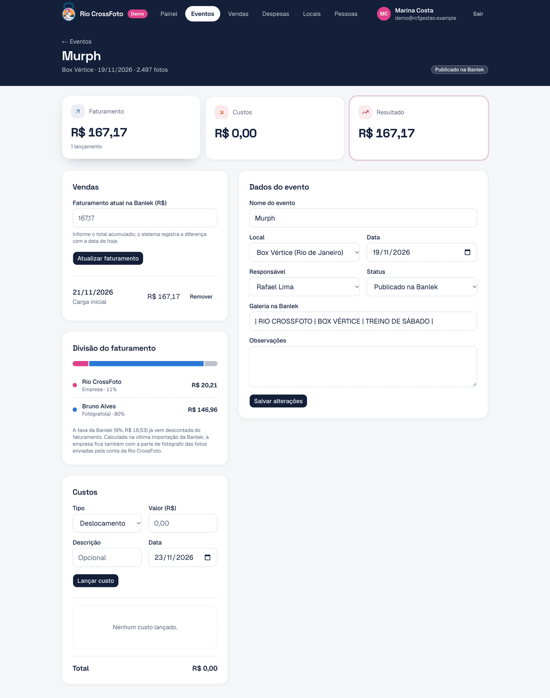
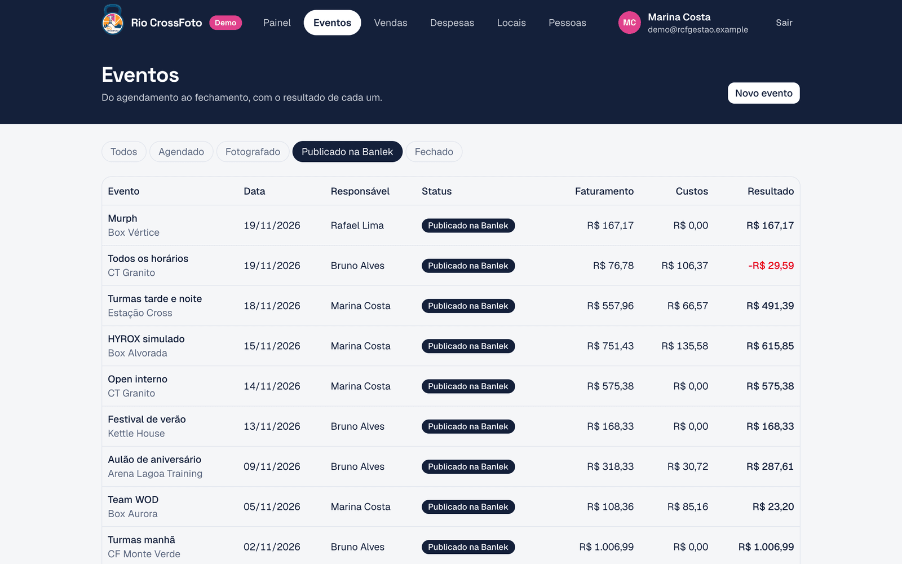
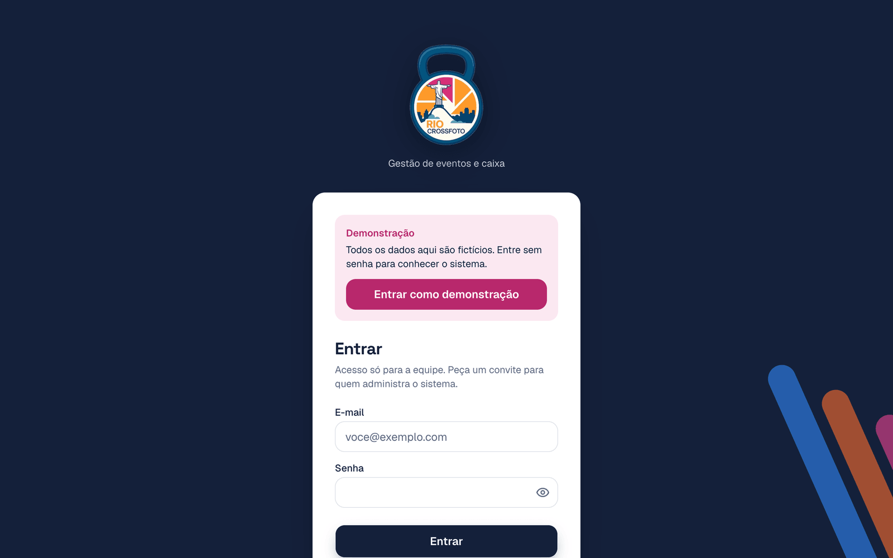
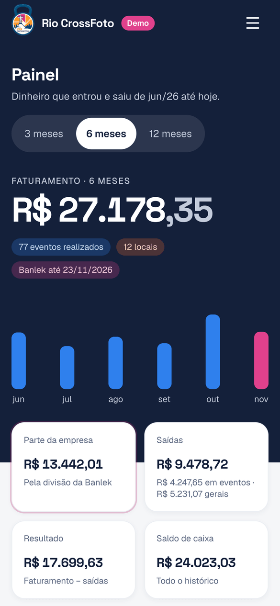
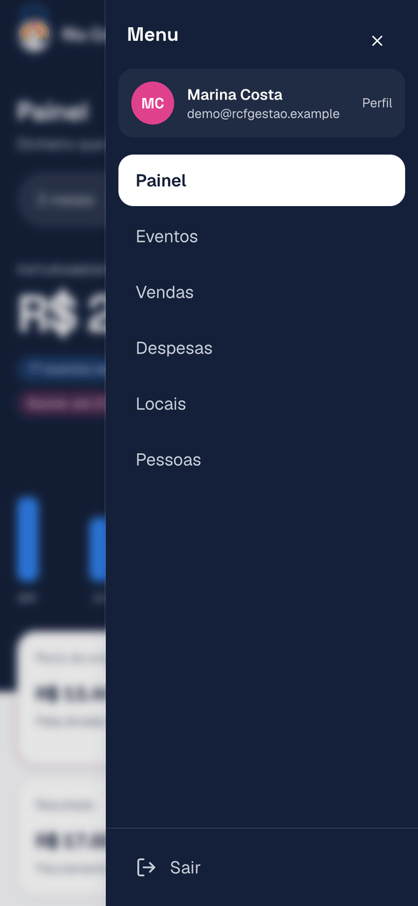

# RCF Gestão

Internal events and cash-flow system for Rio CrossFoto, a CrossFit event photography company.
Context, decisions and roadmap are in [docs/case.md](docs/case.md); the product and design
principles are in [PRODUCT.md](PRODUCT.md) and [DESIGN.md](DESIGN.md).

The app UI is in Brazilian Portuguese; screen names below are given as they appear in the app.

## Live demo

**https://rcf-gestao.vercel.app** — click **"Entrar como demonstração"** on the login screen.
(Or sign in with `demo@rcfgestao.example` / `demo-rcf-2026`.)

Everything in the demo is fictional: venues, people, events, sales and revenue splits are generated
by [`scripts/gerar-demo.mjs`](scripts/gerar-demo.mjs). The production system runs on a separate,
private database with the company's real Banlek data, which is not part of this repository.

A 1-minute walkthrough recorded on the demo is in [`docs/demo.webm`](docs/demo.webm).

| Dashboard | Event with revenue split |
| --- | --- |
|  |  |

| Events | Login | Mobile | Mobile menu |
| --- | --- | --- | --- |
|  |  |  |  |

## Features

### Records

- **Login** for the team only (public sign-up is disabled in Supabase), with a show/hide password toggle.
- **Locais** (venues): CrossFit boxes and organizers, with neighborhood, city, contact and the events held there.
- **Pessoas** (people): partners, photographers and administrators; people can be deactivated without losing history.
- **Eventos** (events): venue, date, person in charge, status and the Banlek gallery, with links to the
  public album and to the event in the Banlek dashboard.
- **Custos** (event costs): quick entry, designed for phones, with a calculated total.
- **Meu perfil** (my profile): change your name and password (the current password is checked first).

### Dashboard

- **Painel** (`/painel`, home): revenue for the period, company share, outflows, result and cash balance,
  monthly chart and table, margin per venue and per event, payouts per person and upcoming events;
  3, 6 or 12-month filter.

### Sales and expenses

- **Vendas** (`/vendas`): lists events with their recorded revenue and a field for the new accumulated
  total copied from the Banlek dashboard. Only the difference is stored, dated today, so the monthly
  chart shows when the money came in. A total lower than the recorded one is rejected (remove the entry
  on the event page instead).
- Each event page has the same field and the list of entries, with an option to remove them.
- **Despesas** (`/despesas`): company-wide expenses, grouped by month, with a category.

Long lists are paginated (10, 20, 50 or 100 per page, 20 by default).

## Stack

Next.js 16 (App Router, Server Actions, Cache Components), TypeScript, Tailwind CSS 4, shadcn/ui,
Recharts, Supabase (Postgres, Auth, RLS) and Zod. Deployed on Vercel.

## Running locally

Requires Node 20+, pnpm, Docker and the [Supabase CLI](https://supabase.com/docs/guides/cli).

```bash
pnpm install
pnpm db:start          # starts local Supabase and applies the migrations
pnpm db:reset          # recreates the database from supabase/seed.sql
cp .env.example .env.local
```

Set `NEXT_PUBLIC_SUPABASE_PUBLISHABLE_KEY` in `.env.local` to the publishable key shown by
`supabase status`. Then:

```bash
pnpm dev
```

Sign in at http://localhost:3000 with the seed user: `dev@rcf.test` / `dev-senha-123`.
New users are created in Supabase Studio (http://127.0.0.1:54323 → Authentication).

## Structure

```
supabase/migrations/   schema, enums, the eventos_resumo view and RLS policies
supabase/seed.sql      local development data and user
supabase/carga/        data exported from Banlek (events and revenue split)
scripts/               Banlek import script
src/proxy.ts           refreshes the session and redirects signed-out users
src/lib/dominio.ts     labels, Zod schemas and formatting (BRL, dates)
src/lib/acao.ts        validation and common errors for Server Actions
src/lib/financeiro.ts  dashboard numbers
src/app/(app)/         authenticated screens
```

## Banlek import

Banlek has no public API. Events come from its own dashboard ("Eventos → Meus eventos"): with a
signed-in session, the page calls `painel-api.banlek.com/api/events/meus-eventos`, and the responses
from every page become `supabase/carga/banlek-eventos.json` (id, album code, title, date, address,
accumulated revenue, photo count and status).

The script reads the JSON, identifies the venue from the title (`| RIO CROSSFOTO | VENUE | EVENT |`)
or, when the title doesn't name it, from the address registered on Banlek, and writes venues, events
and revenue as sales. The event key is the Banlek id (`banlek_id`), so running it again never
duplicates anything, and only the difference to what is already recorded is added to revenue
(including what was entered on the Vendas screen). Events with a future date are created as scheduled.

Name mappings (venues and team members) live in `supabase/carga/mapeamento.json`;
[`mapeamento.example.json`](supabase/carga/mapeamento.example.json) shows the format. The real
files under `supabase/carga/` are not included in this public repository.

Each event's revenue split (the "Colaboradores" tab: rates, administrator and photographers with what
they sold) is in `supabase/carga/banlek-divisao.json`. Banlek revenue already excludes Banlek's own fee
(9%); the script splits the rest between administrator, photographers and the company (which keeps the
remainder, including the photographer share of photos uploaded from the Rio CrossFoto account) and
writes it to `divisoes`. The dashboard uses it for the company share and the payouts per person.

```bash
node scripts/importar-banlek.mjs supabase/carga/banlek-eventos.json supabase/carga/banlek-divisao.json > /tmp/banlek.sql
supabase db query --linked -f /tmp/banlek.sql
```

New venues must be added to `LOCAIS` (by title) or `LOCAIS_POR_ENDERECO` in the script; it stops with
a message when it finds one it doesn't know.

## Demo data

`scripts/gerar-demo.mjs` generates the public demo: 12 venues, ~120 events over the last 8 months and
the next 6 weeks, sales with a realistic post-event curve, revenue splits in the Banlek patterns, costs,
expenses and the demo login. It is deterministic, dates are relative to the day it runs, and it refuses
to run on a database that has events imported from Banlek.

```bash
node scripts/gerar-demo.mjs > /tmp/demo.sql
supabase db query --linked -f /tmp/demo.sql   # on the demo project only
```

Setting `DEMO_EMAIL` and `DEMO_SENHA` on the deployment shows the "Entrar como demonstração" button,
adds a "Demo" tag to the header and blocks name and password changes for the demo user.

## Mock data

The older, smaller mock below is for quick local demos and must not be mixed with real data.

`supabase/mock/carregar.sql` creates 10 venues, 10 people, 10 events (in every status), their costs
and sales, and company expenses. `supabase/mock/limpar.sql` removes all of it.

```bash
supabase db query --linked -f supabase/mock/carregar.sql
supabase db query --linked -f supabase/mock/limpar.sql
```

The types in `src/lib/database.types.ts` are generated from the linked Supabase project.
After applying a migration (`supabase db push`), regenerate them with `pnpm db:types`.
